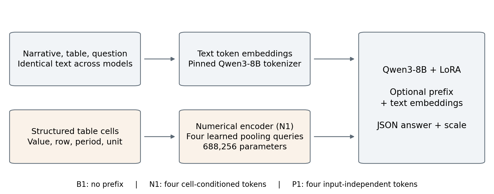
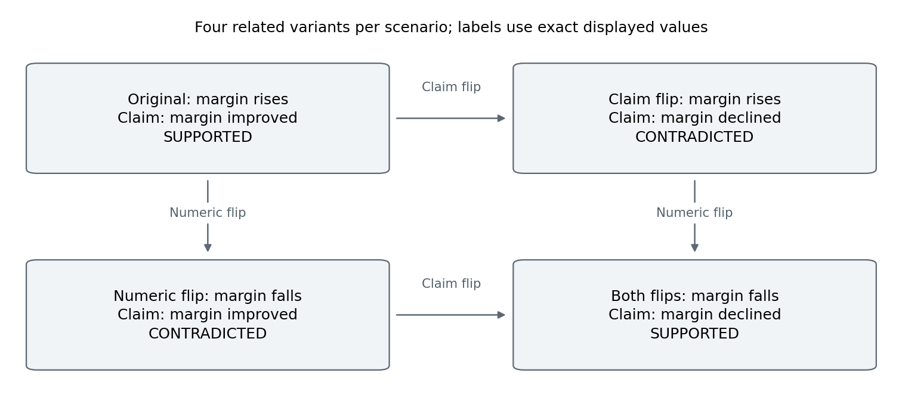

# Meridians: Numerical Representations and Structured Answers in Financial Question Answering

Alina Khay · November 2026

## Abstract

Structured financial question answering connects language, table values and explicit answer conventions. We present Meridians, a controlled study of text-only QLoRA, a typed numerical prefix and an input-independent learned prefix on Qwen3-8B. Nine adapters span three predetermined training seeds, using the same 256 arithmetic questions and 64 optimizer updates. The restricted TAT-QA test yields mean exact match of 33.33% for text-only adaptation, 23.44% for the numerical prefix and 31.77% for the learned prefix. FinQA raw reference agreement is 15.10%, 9.90% and 13.02%, respectively, with reference-unit conventions qualifying its interpretation. On 32 synthetic counterfactual quartets, strict label accuracy and a separately disclosed post-hoc scale-agnostic diagnostic reveal a strong distinction between label choice and output serialization. Numerical-input interventions and recorded training gradients further characterize the numerical pathway. The study identifies representation alignment, variation across training seeds and structured-answer conventions as distinct dimensions for evaluating numerical adaptation. All predetermined conditions, raw predictions, scoring procedures and release checkpoints support inspection and reproduction.

## Introduction

Financial question answering draws on prose, tabular evidence, numerical operations and conventions for reporting values. A model can choose an appropriate answer while serializing its units differently from an evaluation schema. Conversely, a well-formed answer may contain an incorrect value. Studying numerical representations therefore benefits from controlled comparisons that preserve these distinctions.

Meridians examines a compact numerical pathway added to an existing decoder. The central question is how a cell-conditioned prefix changes financial-QA adaptation when the original narrative, table text, training examples and number of optimizer updates are held fixed. The study compares an unadapted reference, text-only QLoRA, a typed numerical prefix and a learned prefix that is independent of each input.

The contributions are threefold. First, we provide a matched three-seed comparison with explicit parameter counts and a secondary prefix-position control. Second, we combine frozen arithmetic tests with balanced counterfactual quartets, separating the primary structured-answer scores from an explicitly post-hoc label diagnostic. Third, we connect these outcomes to numerical-input interventions and recorded optimization measurements, with every predetermined seed and complete prediction coverage retained. The contribution is an empirical characterization of this particular representation and adaptation recipe; architectural novelty and full-benchmark leadership are outside the scope.

## Related work

FinQA supplies financial questions with expert-authored reasoning programs [1]. TAT-QA combines tables and text with answer-type and scale normalization [2]. Meridians generates direct answers, so its FinQA reference agreement differs from official program equivalence or execution accuracy. Restricted arithmetic samples are reported separately from full-benchmark results.

LUNA augments transformer representations with number plugins and numerical pretraining objectives [3]. Its alignment procedure and architecture differ from a four-token decoder prefix adapted jointly with LoRA. xVal uses continuous numerical tokenization for scientific language models trained from scratch [4]. These works motivate explicit number representations while illustrating that representation design, alignment and training regime are distinct experimental choices. Meridians studies their interaction in an existing financial-QA decoder.

LoRA and QLoRA provide established parameter-efficient and quantized adaptation methods [5,6]. Financial numeral specialization is also established, including FLAN-FinXC [7]. We use the existing Qwen3-8B foundation model [8], and position the study around controlled evaluation and structured answers rather than a new foundation model or a general claim about numerical embeddings.

## Representation and comparison models

B0 is unadapted Qwen3-8B. B1 adds a text-only LoRA adapter. N1 combines the same LoRA configuration with a typed numerical encoder. P1 adds four globally learned prefix vectors to a separately trained text LoRA adapter. P1 never conditions on cell values, coordinates, periods, units or cell counts. Every condition receives the same original narrative, serialized table, question and answer instructions within each evaluation protocol.

For each wholly numeric table cell, N1 encodes sign, log magnitude and fractional part, together with embeddings for row position, relative year or column position, and a conservative unit identifier. Currency symbols, percentages and negative parentheses are parsed. Recognized header years are treated as metadata; missing dashes are not converted into zero and ambiguous scales are not guessed. Four learned attention queries pool valid cells before projection into the decoder embedding space.

Here f is a two-layer value MLP plus row, period and unit embeddings followed by layer normalization. Q contains four learned queries; MHA uses four attention heads and padding mask M, followed by layer normalization and a linear projection into the decoder embedding dimension. The causal decoder consumes four prefix vectors followed by ordinary text embeddings. Row-label semantics remain in text rather than being directly embedded in the numerical pathway, making cross-representation alignment a substantive learning requirement.

| Condition | LoRA parameters | Additional parameters | Total |
| --- | --- | --- | --- |
| B1 text | 15,335,424 | 0 | 15,335,424 |
| N1 numerical prefix | 15,335,424 | 688,256 | 16,023,680 |
| P1 learned prefix | 15,335,424 | 16,384 | 15,351,808 |

Trainable parameter counts. Data order and optimizer updates are matched; sequence length, parameter count and arithmetic operations are not asserted to be equal. P1 controls prefix positions without matching N1 parameter count.

## Data and experimental protocol

### Selected data and split controls

Seeded ID hashes select 128 training and 64 development arithmetic questions from each source, totaling 256 training and 128 development examples. Complete prompts must fit 1,920 tokens, targets at most 128 tokens and structured input at most 128 numerical cells. No gold-evidence retrieval or silent context or cell truncation is used. Selected maximum text-plus-target lengths are 1,898 training and 1,900 development tokens.

FinQA training company/year groups present anywhere in the official development split are excluded before selection. Selected training and development contexts are disjoint. Company/year paths are report proxies, and TAT-QA table UUIDs do not establish original-document disjointness. Public benchmark exposure during backbone pretraining is unknown.

A separate seed-1,337 selection freezes 64 FinQA and 64 TAT-QA arithmetic test questions before final prediction. FinQA report groups used in the selected training or development data are excluded. Final selection uses task type and complete-input bounds without target-length filtering. The selected arithmetic questions represent a restricted test sample, rather than full-benchmark coverage.

The synthetic transfer set contains 32 held-out scenarios, each with four versions: original, claim-only flip, numerical-direction-only flip, and both flips. Labels are recomputed from the exact displayed rounded revenue and operating-income values, giving two supported and two contradicted labels per quartet. A claim-wording-only strategy can reach 50% case accuracy but cannot solve a complete quartet. These scenarios do not enter adapter training.

### Adaptation and inference

The backbone is Qwen/Qwen3-8B at revision b968826d9c46dd6066d109eabc6255188de91218. Adaptation uses NF4 four-bit double quantization; rank-16 LoRA with alpha 32 and dropout 0.05 on q/k/v/o projections; AdamW learning rate 0.0001; batch size one with accumulation four; and global gradient norm clipping at one. Each adapter completes one epoch and exactly 64 optimizer updates. A dedicated data-loader generator separates example order from numerical-encoder initialization; actual order hashes agree within each matched seed.

Seeds 42, 11 and 23 are predetermined and all are reported. The release checkpoints use seed 42, fixed before final prediction rather than selected by test performance. Saved adapters are reloaded for inference. The P1 control was specified after development observations and before control training and all final-test prediction. N1 minus B1 remains the primary contrast; the prefix comparisons are development-informed secondary analyses.

Generation is greedy with thinking disabled. Outputs contain answer strings and a scale string. Development permits 128 generated tokens; the final protocol permits 64. Development observations motivated writing the empty-string scale literally in the final prompt, identically for every model. The changes were fixed before final prediction, so development-to-test differences also reflect these documented protocol adjustments.

### Metrics and uncertainty

TAT-QA uses its pinned official EM/F1 implementation and scale normalization, with only an import-path adjustment. FinQA raw reference agreement compares direct answers with released execution references at five decimals. Prediction percentage notation is normalized without consulting the reference. The released references contain mixed percentage conventions, so this measure is not official program accuracy or a pure arithmetic measure. Schema-noncompliant outputs remain wrong in the frozen primary scores; no parser selects a number by matching the reference.

A reference-only unit diagnostic was frozen before test prediction. Explicit percentage annotations support conversion only when display rounding and five-decimal execution rounding identify unambiguous percentage-point units. Ambiguous or inconsistent references retain their original values and are flagged. No model prediction enters this rule, no case is excluded by model score and original adaptation targets remain unchanged. The raw primary score and the unit-canonical diagnostic are reported separately.

Final paired intervals resample the three training seeds and paired report, table-context or synthetic-scenario groups 5,000 times. They are descriptive 95% intervals conditional on the selected samples and three seeds, without multiple-comparison correction. Synthetic measures include case labels, all-four-correct scenarios and numerical-flip pairs for which both labels are correct.

## Results

### Financial question answering

| Model | FinQA raw reference (%) | TAT-QA EM (%) |
| --- | --- | --- |
| B0 | 0.00 | 7.81 |
| B1 | 15.10 | 33.33 |
| N1 | 9.90 | 23.44 |
| P1 | 13.02 | 31.77 |

Frozen restricted financial-QA results. Adapted rows average all three predetermined seeds; B0 is one inference. Each source has 64 questions. The base FinQA score is constrained by schema compliance; it does not establish an absence of arithmetic ability.

Text-only adaptation provides the highest mean TAT-QA exact match, 33.33%, followed by the learned prefix at 31.77% and the numerical prefix at 23.44%. All three paired TAT-QA comparisons favor text-only adaptation. N1 minus B1 is -9.90 percentage points, with a conditional descriptive interval of [-20.29, -0.51]. The learned-prefix comparison provides context for the added positions: P1 minus B1 is -1.56 points, with interval [-9.05, 5.21]. The distinct parameter counts and initializations still preclude identifying a single causal mechanism.

FinQA raw reference agreement averages 15.10% for text-only, 9.90% for the numerical prefix and 13.02% for the learned prefix. N1 minus B1 is -5.21 points, with interval [-14.01, 1.04]. The unit-canonical diagnostic leaves these aggregate means unchanged on this selected test. Mixed conventions and potentially inconsistent references continue to qualify both forms of reference agreement.

### Counterfactual labels and structured answers

Strict synthetic case accuracy averages 31.25% for the numerical prefix and 10.68% for text-only adaptation. The N1 scores are 5/128, 2/128 and 113/128 for seeds 42, 11 and 23. Its strict-case advantage is therefore concentrated in one seed. The paired mean contrast is +20.57 points, with descriptive interval [-17.97, 87.50]. All seed outcomes and structured quartet metrics are retained in the appendix.

Inspection of the first completed B0 test outputs showed complete single-label JSON objects with non-empty scale values such as a period or the word increased. This motivated a separately labeled post-hoc diagnostic. It accepts only a complete two-key JSON object, one supported/contradicted label as a string or one-item list, and a scale string whose value is ignored. It does not search prose, choose among multiple answers or consult the reference while parsing. The scalar/list clarification occurred after strict summaries had been inspected but before label-only metrics were calculated. All cases remain in the denominator, with invalid answer structures wrong. No frozen primary score, model input or generated output changes.

| Model | Strict labels (%) | Post-hoc labels (%) | Post-hoc quartets (%) |
| --- | --- | --- | --- |
| B0 | 0.00 | 74.22 | 6.25 |
| B1 | 10.68 | 94.27 | 86.46 |
| N1 | 31.25 | 89.06 | 61.46 |
| P1 | 0.00 | 95.31 | 89.58 |

Separate post-hoc scale-agnostic diagnostic. Quartet accuracy requires all four labels. Adapted rows average three seeds. Primary strict scores remain unchanged.

The diagnostic averages 94.27% label accuracy for text-only, 89.06% for the numerical prefix and 95.31% for the learned prefix, versus 74.22% for B0. Their label-only all-four scenario rates are 86.46%, 61.46%, 89.58% and 6.25%, respectively. The contrast between strict and label-only outcomes identifies answer selection and schema adherence as distinct evaluation dimensions under this prompt. The diagnostic is exploratory and does not independently establish a numerical mechanism or real-world generalization.

### Numerical-input and optimization diagnostics

For the development seed 42 N1 model, zeroing all value features while retaining metadata and masks changes 46/128 raw outputs and zero correctness outcomes. Permuting values across cells with their original metadata fixed changes 39 outputs and three correctness outcomes, with two lost agreements and one gained. The same numerical evidence remains in text throughout. These interventions characterize sensitivity but cannot alone establish either encoded-value utility or pathway inactivity.

The seed 42 median gradient norms before clipping are 2.86 for text-only and 27.68 for N1; maxima are 12.73 and 3060.80. Every one of the 64 recorded updates exceeds the shared clipping threshold. These measurements motivate future tests of separate optimization and explicit numerical alignment objectives; they do not demonstrate that clipping or gradient coupling caused the observed answer differences.

## Discussion and implications

The comparisons support a useful separation of design questions. Prefix-position adaptation, cell-conditioned representations and answer serialization each affect what the evaluation records. In the restricted arithmetic setting, text-only adaptation is a strong reference configuration, while the N1 outcomes identify cross-representation alignment and seed stability as priorities for further study. The learned-prefix control helps contextualize the added positions without resolving parameter-count and optimization differences.

The counterfactual design adds complementary evidence: balanced claim and numerical flips assess consistency across related inputs, while the schema diagnostic shows that strict serialization can substantially change the apparent ordering of models. Reporting both primary structured-answer outcomes and explicitly exploratory label outcomes makes this distinction visible. One seed or one aggregate score would conceal material aspects of the comparison.

Further experiments can examine a parameter-matched text control, alignment objectives before joint adaptation, separate encoder and LoRA optimization, and repeated evaluation after correcting the training target conventions under a new protocol. Longer adaptation and broader contexts are additional scientific questions. These directions are proposals rather than completed results.

## Scope and limitations

The evidence concerns one numerical encoder, an existing backbone and a one-epoch adaptation protocol over 256 selected arithmetic questions. There are only three training seeds, 64 selected questions per public source and 32 synthetic scenarios. The selected complete contexts do not cover long reports, arbitrary answer types or all table structures. Public-benchmark pretraining exposure is unknown, and the synthetic scenarios have not received an independent human realism review.

FinQA reference-unit ambiguity and potential annotation inconsistencies remain material. The shared fractional instruction conflicts with some point-valued adaptation targets. A train/development audit found 71 fractional, three point-valued and six otherwise inconsistent references among 80 selected training percentage annotations, and 29, four and four among 37 development annotations. These are annotation-consistency checks under stated rounding rules, not independent adjudication. A reference program ending with multiplication by 100 illustrates the distinction between 24.69136 percentage points and approximately 0.24691 as a fraction.

P1 controls four prefix positions rather than N1 parameter count; it is development-informed. The scale-agnostic diagnostic is post-hoc. Bootstrap intervals are descriptive and conditional, not population guarantees. All original primary scores and predetermined seeds are retained. The study does not establish operational reliability for financial decisions.

## Conclusion

Meridians provides a controlled account of numerical-prefix adaptation and structured-answer evaluation in financial question answering. The three-seed comparison identifies text-only adaptation as the strongest TAT-QA configuration under the tested recipe, while counterfactual and numerical-input diagnostics characterize distinct aspects of label choice, serialization and representation sensitivity. Together, the findings offer concrete design and evaluation considerations for future numerical-language adaptation studies.

## Artifacts and research transparency

The accompanying materials retain the pinned backbone revision, selected-data identifiers and hashes, the adaptation recipe, raw predictions for every predetermined final condition, analysis definitions, scorer attribution and figure source data. Original predictions are immutable; the full set is locally re-scored using the same pinned task scorers. This verifies the recorded calculations but is not independent human annotation or a separate implementation of each metric.

The released seed 42 artifacts are adapters for Qwen3-8B. Numerical fusion additionally requires the separate encoder and the tested four-token prefix path. An adapter-only LoRA loader does not reproduce N1. Backbone and third-party data licenses remain applicable. The original datasets are obtained from their attributed sources rather than redistributed as newly owned data.

The two Hugging Face model repositories are linked on the first page and provide the corresponding adapters, tested inference loader and source-data attribution. The companion Meridians Counterfactuals dataset releases the 128 original synthetic evaluation cases in 32 scenarios, with exact decimal evidence, input hashes, label rules and a deterministic reconstruction script. It contains no third-party financial-QA corpus content and no training split.

The dedicated research explorer provides all 1,280 recorded synthetic responses across ten conditions, independent claim and numeric-flip controls, all three predetermined seeds, full condition-level summary metrics and the paper figures. It is an interface to recorded evidence, not live inference. The complete research release retains all 2,560 final prediction texts. Related counterfactual variants share scenario identifiers for grouped analysis; future training on this released test suite would invalidate a fresh held-out claim on those cases.

All 2,560 final predictions are complete. A second generation stage appends only 400 remaining records, preserving earlier answers, including a 112-record partial prefix, byte-for-byte. Weights, inputs, prompts and decoding are fixed; no completed answer is regenerated or used for model selection.

The FinQA executor was checked against 6,251 training and 883 development gold programs, with target-serialization checks. These are software checks, distinct from model scores. Raw predictions support local re-scoring.

## Complete final outcomes

| Condition | FinQA raw | TAT-QA EM | Strict CF | Strict quartets |
| --- | --- | --- | --- | --- |
| B0 | 0.00 | 7.81 | 0.00 | 0.00 |
| B1 / seed 42 | 17.19 | 32.81 | 12.50 | 0.00 |
| N1 / seed 42 | 6.25 | 23.44 | 3.91 | 0.00 |
| P1 / seed 42 | 15.62 | 35.94 | 0.00 | 0.00 |
| B1 / seed 11 | 12.50 | 35.94 | 19.53 | 0.00 |
| N1 / seed 11 | 10.94 | 23.44 | 1.56 | 0.00 |
| P1 / seed 11 | 10.94 | 29.69 | 0.00 | 0.00 |
| B1 / seed 23 | 15.62 | 31.25 | 0.00 | 0.00 |
| N1 / seed 23 | 12.50 | 23.44 | 88.28 | 56.25 |
| P1 / seed 23 | 12.50 | 29.69 | 0.00 | 0.00 |

All frozen final outcomes (%). FinQA and TAT-QA each contain 64 questions; CF contains 128 cases in 32 quartets. B0 is evaluated once. No seed is chosen by test performance.

| Model | FinQA schema | TAT-QA schema | CF schema |
| --- | --- | --- | --- |
| B0 | 0.00 | 100.00 | 0.00 |
| B1 | 100.00 | 97.40 | 10.94 |
| N1 | 91.15 | 88.02 | 35.16 |
| P1 | 100.00 | 98.44 | 0.00 |

Strict schema compliance (%), distinct from answer correctness. Adapted rows average three seeds. Every schema-noncompliant output remains wrong in the primary score.

## Secondary contrasts and reference diagnostics

| Contrast | Source | Difference (pp) | 95% descriptive interval |
| --- | --- | --- | --- |
| P1_minus_B1 | finqa | -2.08 | [-5.73, 1.08] |
| P1_minus_B1 | tatqa | -1.56 | [-9.05, 5.21] |
| N1_minus_P1 | finqa | -3.12 | [-11.98, 3.39] |
| N1_minus_P1 | tatqa | -8.33 | [-17.68, 0.00] |

Development-informed secondary prefix contrasts, using all three predetermined seeds. These are not additional independent confirmatory tests.

Unit-canonical FinQA means equal raw reference agreement on this sample: B0 0.00%, B1 15.10%, N1 9.90% and P1 13.02%. Reference ambiguity remains.

A separate post-hoc development diagnostic accepts the literal scale word empty and error of 1% relative or 0.0001 absolute. Agreements change from 2/6/3 to 14/26/17 out of 64 for B0/B1/N1. These exploratory counts combine format and precision adjustments and do not replace exact scoring.

